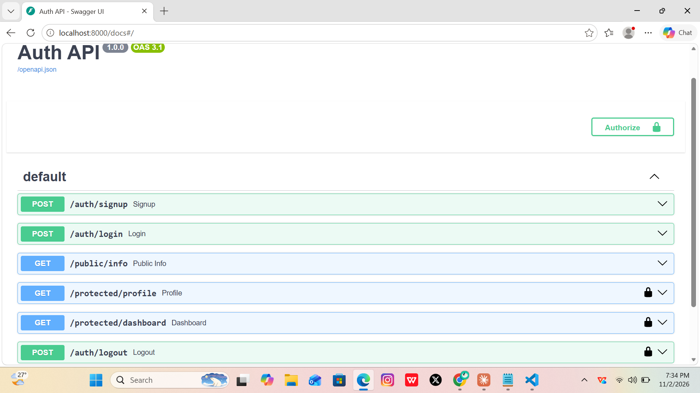

# Auth API: Login & Protect

A secure REST API built with **FastAPI** and **Supabase Auth**. Users can sign up, log in and log out. Protected routes verify the user's JWT with Supabase before they respond.

## Setup

1. Clone the repo and enter the folder:
   ```bash
   git clone https://github.com/YOUR_USERNAME/auth-login.git
   cd auth-login
   ```
2. Create and activate a virtual environment, then install dependencies:
   ```bash
   python -m venv venv
   venv\Scripts\activate        # Mac/Linux: source venv/bin/activate
   pip install -r requirements.txt
   ```
3. Copy `.env.example` to `.env` and fill in your Supabase values
   (Project Settings → API in the Supabase dashboard). Use the **anon/publishable** key, never the service_role key.
   ```
   SUPABASE_URL=your_project_url
   SUPABASE_KEY=your_anon_key
   PORT=8000
   ```
4. In Supabase, go to Authentication → Sign In / Providers → Email and turn **Confirm email** off (practice project only).

## Run

```bash
uvicorn main:app --reload --port 8000
```

Interactive docs: http://localhost:8000/docs

## API reference

| Method | Route | Auth needed | Purpose | Success |
|---|---|---|---|---|
| POST | `/auth/signup` | No | Create an account | 201 |
| POST | `/auth/login` | No | Log in, returns JWT | 200 |
| POST | `/auth/logout` | Bearer token | End the session | 204 |
| GET | `/protected/profile` | Bearer token | Read private profile | 200 |
| GET | `/protected/dashboard` | Bearer token | Second protected route | 200 |
| GET | `/public/info` | No | Public info | 200 |

Errors: `400` missing input, `401` missing, malformed or invalid/expired token. Every error returns JSON like `{"error": "..."}`.

## How auth works

Supabase stores the accounts, hashes passwords and signs the JWTs. This server never stores a password. A reusable FastAPI dependency (`get_current_user`) extracts the Bearer token and verifies it with `supabase.auth.get_user()`. Any route that adds `Depends(get_current_user)` is protected.

## Swagger UI

